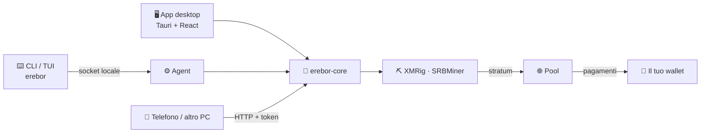

<div align="center">

<picture>
  <source media="(prefers-color-scheme: dark)" srcset="brand/erebor-mark-dark.svg">
  
</picture>

# Erebor

### Mining, under your control.

Il mining manager **open source**, **non-custodial** e **local-first**.<br>
Avvia, osserva e guadagna dal tuo computer, senza mai cedere il controllo del tuo wallet.

[](https://github.com/samuelviviani/erebor/releases/latest)
[](https://github.com/samuelviviani/erebor/actions/workflows/ci.yml)
[](https://github.com/samuelviviani/erebor/releases)
[](LICENSE)
<br>


[**⬇️ Scarica**](https://github.com/samuelviviani/erebor/releases/latest) ·
[**💻 Da terminale**](#-da-terminale) ·
[**📚 Documentazione**](#-documentazione) ·
[**🤝 Contribuisci**](CONTRIBUTING.md)

</div>

---

## ✨ Perché Erebor

<table>
<tr>
<td width="50%" valign="top">

### 🔐 Non-custodial
Solo indirizzi pubblici. Mai seed phrase, mai chiavi private: la pool paga **direttamente** il tuo wallet.

</td>
<td width="50%" valign="top">

### 🔍 Trasparente
Commissione Erebor (2% del tempo di mining effettivo), donazione XMRig e fee della pool descritte sul sito; lo stato mostra in tempo reale per chi si sta minando.

</td>
</tr>
<tr>
<td valign="top">

### 🏠 Locale
Configurazione e statistiche restano sul tuo computer. Nessun account, nessuna telemetria.

</td>
<td valign="top">

### 🛑 Niente mining nascosto
Il mining parte solo con una tua azione esplicita e si ferma quando chiudi l'app.

</td>
</tr>
</table>

## 🚀 Cosa fa

- ⛏️ **CPU e GPU**: [XMRig](https://github.com/xmrig/xmrig) per il processore, [SRBMiner-MULTI](https://github.com/doktor83/SRBMiner-Multi) per le schede video NVIDIA/AMD, scaricati dalle release ufficiali e verificati con SHA-256.
- 🧠 **Moneta automatica**: prova le monete compatibili con il tuo PC, misura l'hashrate reale e mina la più redditizia.
- 💸 **Ricevi come preferisci**: account Kryptex, wallet Bitcoin (via unMineable) o indirizzo Monero.
- 📊 **Tutto sotto gli occhi**: hashrate, share, guadagni stimati, temperature, consumi e costo dell'energia.
- 🌡️ **Protezioni**: soglie termiche ed economiche, programmazione oraria, ripresa automatica dopo un crash.
- 📱 **Dal telefono**: accesso remoto dalla rete di casa o via VPN.
- 🔄 **Aggiornamenti automatici**: app e versione da terminale si aggiornano da sole dalle release firmate su GitHub.
- 🌍 Italiano e inglese · tema chiaro e scuro · **modalità demo** per provare senza minare.

## ⬇️ Installazione

Scarica l'ultima versione dalla pagina **[Releases](https://github.com/samuelviviani/erebor/releases/latest)**:

| Sistema | File | |
|---|---|---|
| 🪟 **Windows 10/11** | `Erebor_x.y.z_x64-setup.exe` · `.msi` | consigliato il `setup.exe` |
| 🐧 **Linux** | `Erebor_x.y.z_amd64.AppImage` · `.deb` | l'AppImage si aggiorna da solo |
| 🍎 **macOS** | `Erebor_x.y.z_universal.dmg` | Apple Silicon e Intel |

> [!TIP]
> Verifica sempre l'integrità del file scaricato con `SHA256SUMS`, allegato a ogni release. Dettagli in [INSTALLATION.md](INSTALLATION.md).

## 💻 Da terminale

CLI, dashboard testuale e agent in background per **Linux, macOS e WSL2**. Un solo comando compila, installa in `~/.local/bin` (senza root) e avvia il setup guidato:

```bash
curl -fsSL https://raw.githubusercontent.com/samuelviviani/erebor/main/scripts/install.sh \
  | sh -s -- --repo https://github.com/samuelviviani/erebor.git
```

Poi:

```bash
erebor                        # dashboard live (al primo avvio: setup guidato)
erebor start                  # avvia il mining, che continua in background
erebor stop                   # ferma il mining
erebor status                 # riepilogo veloce
erebor service on             # mina sempre, anche dopo un riavvio del computer
erebor demo on                # prova con un miner simulato
```

- 📊 **Dashboard** con logo, hashrate, guadagni, temperature e tasti rapidi.
- 🔁 **Mina sempre**: con `erebor service on` Erebor riparte da solo a ogni accensione.
- 🔄 **Si aggiorna da sola**, come l'app: ogni ora controlla le release firmate su GitHub (oppure `erebor update`).

CLI, TUI e app desktop comandano **lo stesso motore**: un solo miner, un solo stato.
Guide: [CLI](docs/CLI.md) · [Agent](docs/AGENT.md) · [TUI](docs/TUI.md) · [Fleet](docs/FLEET.md)

## 🧱 Architettura



| Percorso | Contenuto |
|---|---|
| `crates/erebor-core` | Libreria Rust: miner, dev fee, guadagni, pool, hardware, SQLite, IPC locale, Fleet |
| `crates/erebor-agent` | Agent: possiede motore e miner, socket locale, servizio systemd utente opzionale |
| `crates/erebor-cli` | CLI `erebor`: status, doctor, mining, wallet, pool, hardware, agent |
| `crates/erebor-tui` | Dashboard da terminale (`erebor monitor`) |
| `apps/desktop` | App Tauri 2 (React + TypeScript + Tailwind) |
| `apps/website` | Sito pubblico Next.js (export statico) |

Dettagli in [docs/ARCHITECTURE.md](docs/ARCHITECTURE.md).

## 🛠️ Sviluppo

```bash
pnpm install
pnpm --filter @erebor/desktop tauri dev   # app desktop (richiede Rust + dipendenze Tauri)
pnpm --filter @erebor/desktop dev         # solo UI nel browser, backend simulato
pnpm --filter @erebor/website dev         # sito
pnpm test && cargo test --workspace       # test
```

Guida completa in [DEVELOPMENT.md](DEVELOPMENT.md). Le pull request sono benvenute: leggi prima [CONTRIBUTING.md](CONTRIBUTING.md). 💛

## 📚 Documentazione

| | |
|---|---|
| 🏗️ [Architettura](docs/ARCHITECTURE.md) | ⌨️ [CLI](docs/CLI.md) · [Agent](docs/AGENT.md) · [TUI](docs/TUI.md) |
| 📦 [Installazione](INSTALLATION.md) | 🛰️ [Fleet](docs/FLEET.md) · [Pool](docs/POOLS.md) |
| 🧑‍💻 [Sviluppo](DEVELOPMENT.md) | 🚢 [Rilascio](docs/RELEASE.md) · [Changelog](CHANGELOG.md) |
| 🔒 [Sicurezza](SECURITY.md) · [Privacy](PRIVACY.md) | 📜 [Licenze di terze parti](THIRD_PARTY_NOTICES.md) |

## 📄 Licenza

Erebor è distribuito con licenza **MIT** ([LICENSE](LICENSE)).
XMRig (GPLv3) e SRBMiner sono progetti separati e **non sono inclusi** nei pacchetti: vengono scaricati dalle release ufficiali e verificati con SHA-256.

> [!WARNING]
> Il mining comporta costi energetici e **non garantisce alcun rendimento**. Controlla il prezzo dell'elettricità prima di iniziare.

<div align="center">
<br>
<sub>Fatto con 🦀 e ☕ · se Erebor ti è utile, lascia una ⭐</sub>
</div>
