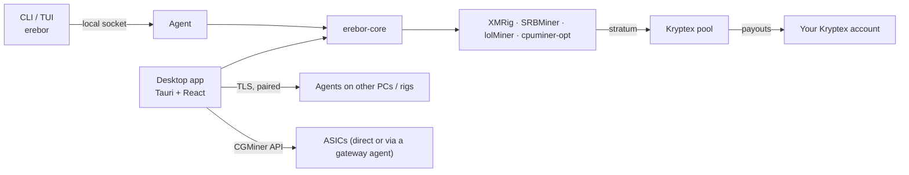

<div align="center">

<picture>
  <source media="(prefers-color-scheme: dark)" srcset="brand/erebor-mark-dark.svg">
  
</picture>

# Erebor

### Mining, without the maze.

An **open-source**, **local-first**, **non-custodial** mining manager.<br>
It mines on your computer, and manages your other PCs, servers, rigs and ASICs from one dashboard.

[](https://github.com/samuelviviani/erebor/releases/latest)
[](https://github.com/samuelviviani/erebor/actions/workflows/ci.yml)
[](https://github.com/samuelviviani/erebor/releases)
[](LICENSE)
<br>


[**Download**](https://github.com/samuelviviani/erebor/releases/latest) ·
[**Command line**](#command-line) ·
[**Documentation**](#documentation) ·
[**Contributing**](CONTRIBUTING.md)

</div>

---

## The problem

Mining from a home computer sounds simple and isn't. You have to pick a coin among dozens,
find a pool, download a miner from a site you hope is the real one, write its command line,
and then keep up as profitability shifts every day. Most people give up, or end up running
something they can't verify.

Erebor does that work for you, in the open:

- **It picks the coin.** It recognises your graphics card, reads public profitability data
  (WhatToMine, Kryptex) and mines what pays most today, re-checking every half hour.
  You can always choose a coin yourself.
- **It runs only verified miners.** Official releases of XMRig, SRBMiner-MULTI, lolMiner and
  cpuminer-opt, checked against a SHA-256 pinned in this repository before they are installed.
  They update by themselves; you can turn that off.
- **It shows what it really earns.** Estimated earnings minus electricity, next to a link to
  your real balance on Kryptex.
- **You stay in charge.** Mining starts only when you say so, stops when you quit the app,
  and stops by itself if the computer runs too hot.

> [!WARNING]
> Mining uses a lot of power and **guarantees no return**. With expensive electricity it can
> cost more than it earns: check the estimate before you start.

## What it mines

Everything the [Kryptex pool](https://pool.kryptex.com) offers that a computer can mine.
By default earnings arrive in BTC on your own Bitcoin wallet through
[unMineable](https://unmineable.com) (no account); a Kryptex account works too. If you already
mine, you can send each coin to your own wallet on the pool you prefer (2Miners, HeroMiners,
WoolyPooly, MoneroOcean, your P2Pool node or any stratum pool), with a backup pool.

| Hardware | Coins | Miner |
|---|---|---|
| Graphics card (NVIDIA/AMD) | Pearl, Ethereum Classic, EthereumPoW, Ergo, Ravencoin, Xelis, Quantus, Quai, OctaSpace; with your own wallet or unMineable: Qubitcoin, Firo, Zano, Neurai, Iron Fish | SRBMiner-MULTI |
| Graphics card (NVIDIA/AMD) | Alephium, Conflux, Nexa, Kaspa, Tari (SHA3x, C29); with your own wallet or unMineable: Beam, Karlsen, Radiant | lolMiner |
| Processor | Monero, Zephyr, Tari (RandomX) | XMRig |
| Processor, Windows only | Bitcoin, Bitcoin Cash, Bitcoin SV, eCash, Fractal Bitcoin, DigiByte, Litecoin, Quai (SHA-256, Scrypt) | cpuminer-opt |

The last row is ASIC territory: a PC can mine those coins, but earns almost nothing. Erebor
never picks them on its own. Every coin's sheet in the app lists what mining it takes on your PC
(graphics card, system, miner, payout) and what is missing.

## Install

Download the latest version from **[Releases](https://github.com/samuelviviani/erebor/releases/latest)**:

| System | File | |
|---|---|---|
| **Windows 10/11** | `Erebor_x.y.z_x64-setup.exe` | |
| **Linux** (Ubuntu 22.04+) | `Erebor_x.y.z_amd64.deb` | `sudo apt install ./Erebor_*.deb` |
| **macOS** | `Erebor_x.y.z_universal.dmg` | Apple Silicon and Intel |

Once installed, Erebor updates itself from signed releases.

> [!TIP]
> Check the download against `SHA256SUMS`, attached to every release. Details in
> [INSTALLATION.md](INSTALLATION.md).

On Windows, Defender flags every mining program as "CoinMiner". Erebor explains this and,
only if you agree, excludes its own miners folder (Windows asks for administrator approval).

## Command line

CLI, terminal dashboard and background agent for **Linux, macOS and WSL2**. One command
downloads the signed binary, checks its SHA-256, installs it into `~/.local/bin` (no root)
and starts the guided setup:

```bash
curl -fsSL https://raw.githubusercontent.com/samuelviviani/erebor/main/scripts/install.sh | sh
```

Then:

```bash
erebor                        # live dashboard (first run: guided setup)
erebor start                  # start mining; it keeps running in the background
erebor stop                   # stop mining
erebor status                 # quick summary
erebor service on             # always mine, also after a reboot
erebor demo on                # try it with a simulated miner
```

The CLI, the dashboard and the desktop app drive **the same engine**: one miner, one state.

### Many devices

Install the agent on each computer or server, pair it with a one-time code, and manage
everything from Erebor Desktop or the CLI: no account, no cloud, no open router ports
(LAN or any VPN). ASICs are read through their own API, directly or through a gateway
agent.

```bash
curl -fsSL https://raw.githubusercontent.com/samuelviviani/erebor/main/scripts/install.sh | sh -s -- --agent  # on the other computer
erebor agent setup                                  # show a new 10-minute code later
erebor devices add 192.168.1.20 --code XXXX-XXXX-XXXX   # here (or Devices → Add device)
erebor mining start --group "GPU rigs"
erebor sim --pair                                   # try it all with simulated devices
```

On Linux, setup adds TCP and UDP firewall rules for private local networks when UFW is
active, asking for administrator privileges if needed. Other firewalls may need manual
rules. Discovery uses LAN broadcast and private subnet probes on Unix; across VPNs or
other subnets, enter the address. The agent runs in the background; configure a service
separately if it must start at login.

Guides: [Devices](docs/DEVICES.md) · [Agent on Linux](docs/AGENT-LINUX.md) ·
[on Windows](docs/AGENT-WINDOWS.md) · [ASICs](docs/ASIC.md) · [Protocol](docs/PROTOCOL.md)
It updates itself like the app, from signed GitHub releases (or `erebor update`).
Guides: [CLI](docs/CLI.md) · [Agent](docs/AGENT.md) · [TUI](docs/TUI.md)

## Architecture



| Path | Contents |
|---|---|
| `crates/erebor-core` | Rust library: miners, coin choice, earnings, pool, hardware, SQLite, local IPC, remote protocol, device controller, ASIC adapters |
| `crates/erebor-agent` | Agent: owns the engine and the miners, local socket, optional user service |
| `crates/erebor-cli` | `erebor` CLI: status, doctor, mining, wallet, pool, hardware, agent |
| `crates/erebor-tui` | Terminal dashboard (`erebor monitor`) |
| `apps/desktop` | Tauri 2 app (React + TypeScript + Tailwind) |
| `apps/website` | Public website (Next.js, static export) |

More in [docs/ARCHITECTURE.md](docs/ARCHITECTURE.md).

## Development

```bash
pnpm install
pnpm --filter @erebor/desktop tauri dev   # desktop app (needs Rust + Tauri dependencies)
pnpm --filter @erebor/desktop dev         # UI only in the browser, simulated backend
pnpm --filter @erebor/website dev         # website
pnpm test && cargo test --workspace       # tests
```

Full guide in [DEVELOPMENT.md](DEVELOPMENT.md). Pull requests are welcome: please read
[CONTRIBUTING.md](CONTRIBUTING.md) first.

## Documentation

| | |
|---|---|
| [Architecture](docs/ARCHITECTURE.md) | [CLI](docs/CLI.md) · [Agent](docs/AGENT.md) · [TUI](docs/TUI.md) |
| [Devices](docs/DEVICES.md) · [Protocol](docs/PROTOCOL.md) | [Agent on Linux](docs/AGENT-LINUX.md) · [on Windows](docs/AGENT-WINDOWS.md) |
| [ASICs and gateway](docs/ASIC.md) | [Simulation](docs/SIMULATION.md) |
| [Installation](INSTALLATION.md) | [Pools](docs/POOLS.md) |
| [Development](DEVELOPMENT.md) | [Release](docs/RELEASE.md) · [Changelog](CHANGELOG.md) |
| [Security](SECURITY.md) · [Privacy](PRIVACY.md) | [Third-party notices](THIRD_PARTY_NOTICES.md) |

## License

Erebor is released under the **MIT** license ([LICENSE](LICENSE)).
XMRig (GPLv3), SRBMiner-MULTI, lolMiner and cpuminer-opt (GPLv2) are separate projects and
**are not bundled**: they are downloaded from their official releases and verified with SHA-256.
Erebor keeps 2% of mining time as its fee, shown in the app and on the website.

<div align="center">
<br>
<sub>Made with Rust and coffee · if Erebor is useful to you, leave a star</sub>
</div>
